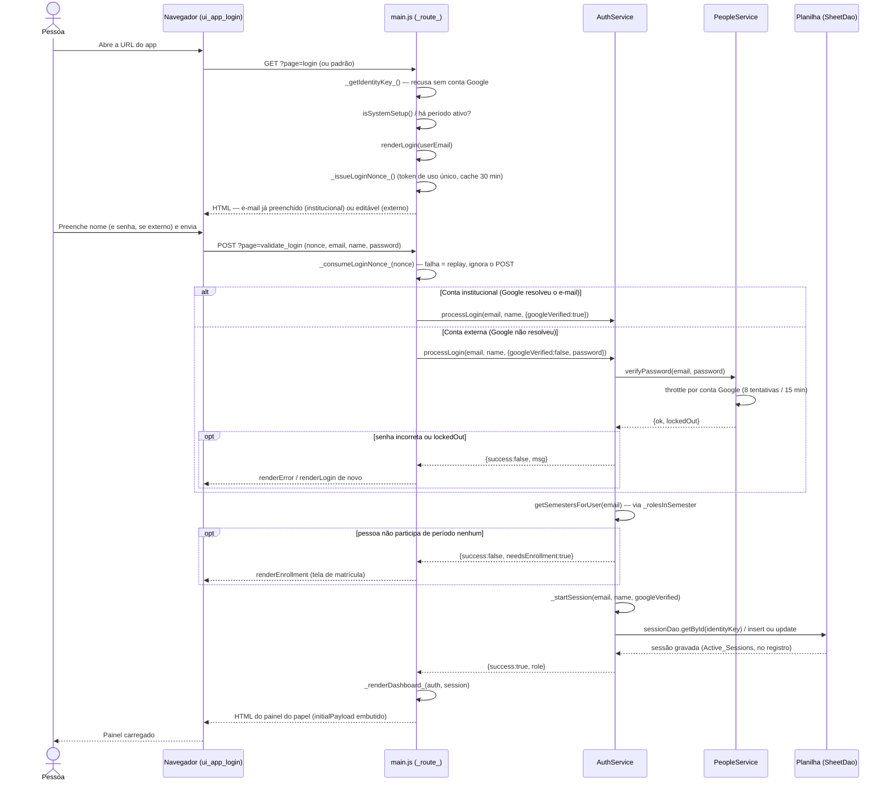

# Login — Cadeia de Chamadas

Duas portas (ver [features/login.md](../features/login.md)): conta institucional
(Google já provou a identidade, sem senha) e conta externa (e-mail digitado como
alegação, só vale com a senha gerada no cadastro). As duas passam pelo mesmo
roteador e pelo mesmo `AuthService`.

Fontes: `src/main.js` (`doGet`/`doPost` → `_route_`, `renderLogin`,
`_issueLoginNonce_`/`_consumeLoginNonce_`), `src/ServiceAuth.js`
(`AuthService.processLogin`, `_startSession`), `src/ServicePeople.js`
(`PeopleService.verifyPassword`).

## Notas

- O nonce (`_issueLoginNonce_`/`_consumeLoginNonce_`) existe porque um F5 na
  resposta do POST oferece reenviar o formulário — sem ele, cada replay
  renovaria a sessão e o timeout nunca seria alcançado (rationale 7.2).
- `_startSession` decide o período (o gravado na sessão, se ainda válido, senão
  o primeiro selecionável) e o papel (o mais privilegiado, na primeira vez).
- Ver também [02-timeout-sessao-reentrada.md](02-timeout-sessao-reentrada.md)
  para o que acontece numa reentrada, e
  [05-matricula-aluno.md](05-matricula-aluno.md) para o caminho de quem ainda
  não participa de período nenhum.
