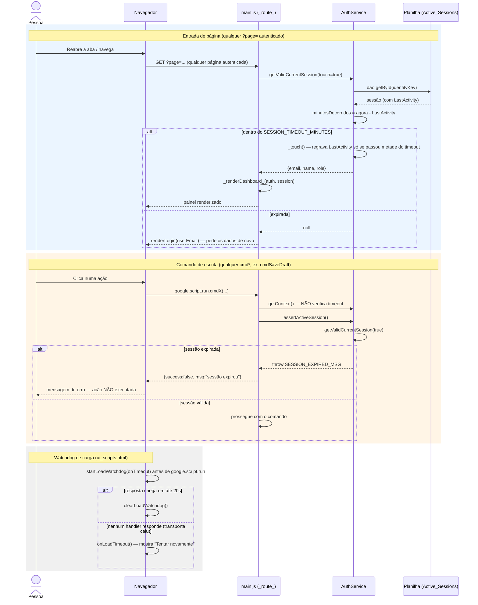

# Timeout de Sessão e Reentrada — Cadeia de Chamadas

O timeout vale para **entrada de página** (todo `doGet` autenticado) e para
**comandos de escrita** (todo `cmd*`); leitura de painel é deliberadamente
tolerante — ver [rationale 1.6](../rationale.md#16-o-timeout-de-sessão-vale-para-escritas-não-só-para-navegação).

Fontes: `src/ServiceAuth.js` (`getValidCurrentSession`, `assertActiveSession`,
`touchCurrentSession`, `_touch`), `src/main.js` (`_route_`), `src/utils.js`
(`SESSION_TIMEOUT_MINUTES`), `src/ui_scripts.html` (watchdog de carga).

## Notas

- `getCurrentProfile()`/`getContext()` **ignoram** o timeout de propósito: um
  `google.script.run` não pode falhar no meio de um trabalho já em andamento
  só porque a leitura de contexto reabriu o relógio.
- O watchdog cobre um caso diferente do timeout: não é sessão expirada, é a
  chamada nunca voltar (nenhum `withSuccessHandler`/`withFailureHandler`
  executa) — ver [rationale 7.8](../rationale.md#78-há-um-watchdog-na-carga-do-painel).
