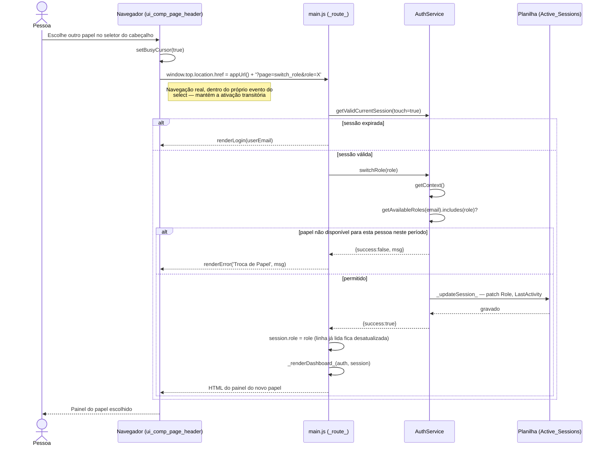

# Troca de Papel — Cadeia de Chamadas

Rota (`?page=switch_role`), não comando `google.script.run` — ver
[rationale 7.3](../rationale.md#73-redirecionamento-vai-na-navegação-não-no-callback):
o app roda num iframe com `allow-top-navigation-by-user-activation`, e a
ativação transitória do Chrome expira poucos segundos depois do clique.
Redirecionar do callback de uma chamada lenta era bloqueado silenciosamente.

Fontes: `src/ui_comp_page_header.html` (`changeUserRole`), `src/main.js`
(`_route_`, trecho `page === 'switch_role'`), `src/ServiceAuth.js`
(`switchRole`, `_updateSession_`).

## Notas

- A checagem de timeout vem **antes** da troca, nunca depois: aplicada
  primeiro, `switchRole` gravaria `LastActivity` e ressuscitaria uma sessão
  expirada sem passar pela tela de login — o mesmo risco de replay que o
  nonce do login fecha (ver
  [rationale 7.2](../rationale.md#72-toda-requisição-reproduzível-precisa-de-nonce-ou-de-ordem-correta)).
- Uma repetição desta URL (F5) reaplica o mesmo papel — inofensivo, por isso
  não há nonce aqui.
