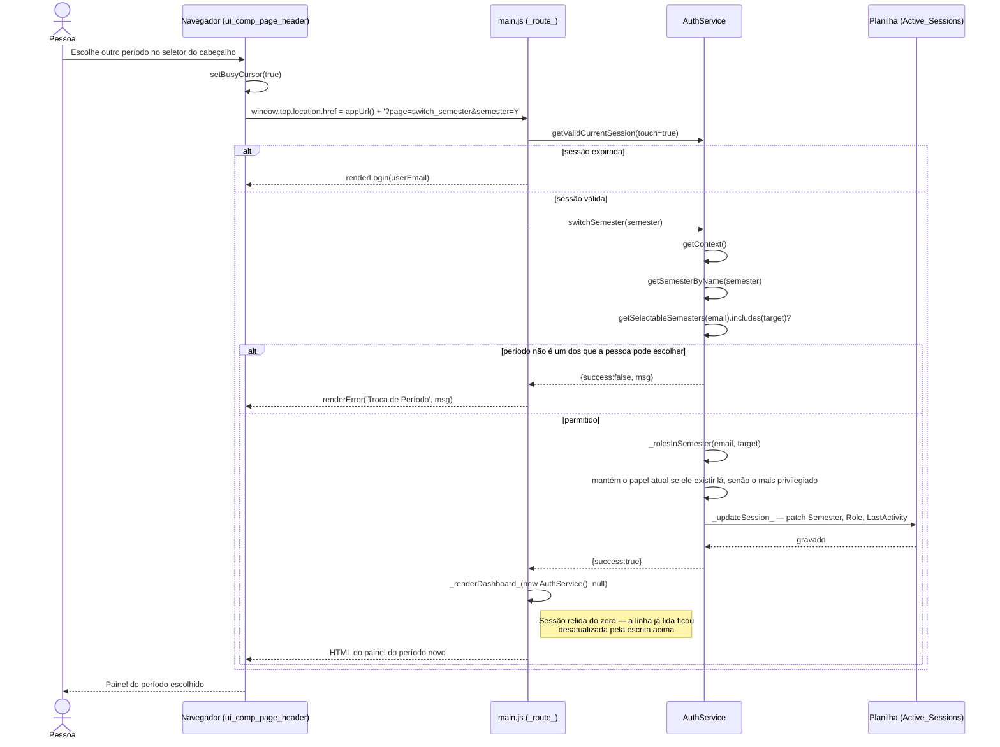

# Troca de Período — Cadeia de Chamadas

Mesmo padrão da troca de papel (rota, não comando) e mesmo motivo — ver
[03-troca-de-papel.md](03-troca-de-papel.md) e
[rationale 7.3](../rationale.md#73-redirecionamento-vai-na-navegação-não-no-callback).
A diferença: o papel é **recomputado** para o período de destino, porque a
mesma pessoa pode ser Responsável num período e só Orientador noutro.

Fontes: `src/ui_comp_page_header.html` (`changeUserSemester`), `src/main.js`
(`_route_`, trecho `page === 'switch_semester'`), `src/ServiceAuth.js`
(`switchSemester`, `_updateSession_`, `_rolesInSemester`).

## Notas

- Bounded por `getSelectableSemesters`, não por `getSemestersForUser`:
  `?page=switch_semester` é uma URL adivinhável, e um aluno preso ao período
  mais novo (ver `AuthService.getSelectableSemesters`) não pode voltar a um
  período anterior só porque tecnicamente ainda tem matrícula lá.
