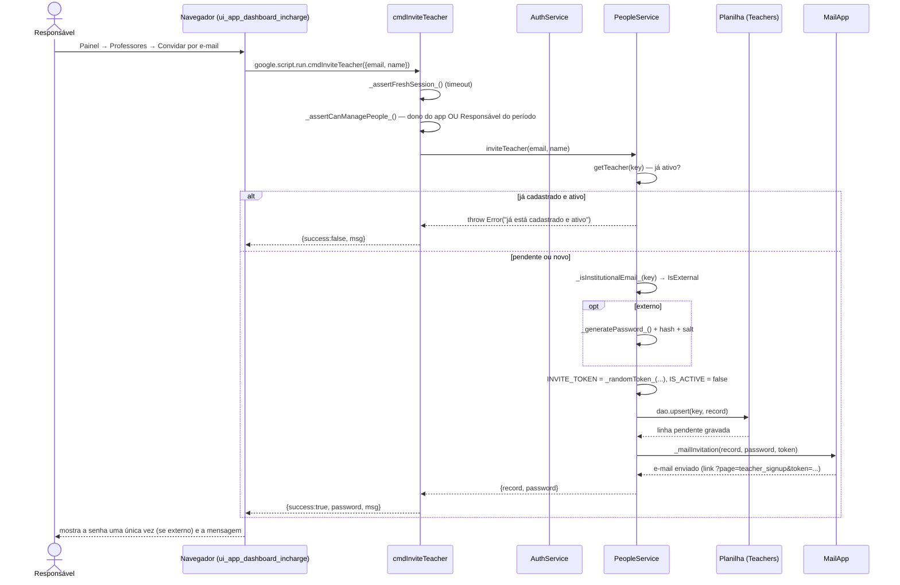

# Convite de Professor por E-mail — Cadeia de Chamadas

O Responsável digita só o endereço; a linha nasce **inativa** e pendente, e a
pessoa completa o próprio cadastro pelo link (ver
[07-professor-completa-cadastro.md](07-professor-completa-cadastro.md)). O
convite é individual: um e-mail, uma vez, 14 dias — ver
[rationale 2.3](../rationale.md#23-auto-cadastro-de-professor-é-escalada-de-privilégio).

Fontes: `src/ui_app_dashboard_incharge.html` (`inviteTeacher`),
`src/ServiceSetup.js` (`cmdInviteTeacher`, `_assertCanManagePeople_`),
`src/ServicePeople.js` (`PeopleService.inviteTeacher`, `_mailInvitation`).

## Notas

- A linha nasce **antes** de a pessoa responder: criar a linha é o próprio ato
  de autorização, e ele é do Responsável — não há cadastro aberto.
- Compare com [24-homologar-banca.md](24-homologar-banca.md): o mesmo
  `inviteTeacher` é chamado em lote, de dentro de
  `PeopleService.inviteCommitteeMembers`, para os membros da banca que o
  sistema ainda não conhece.
