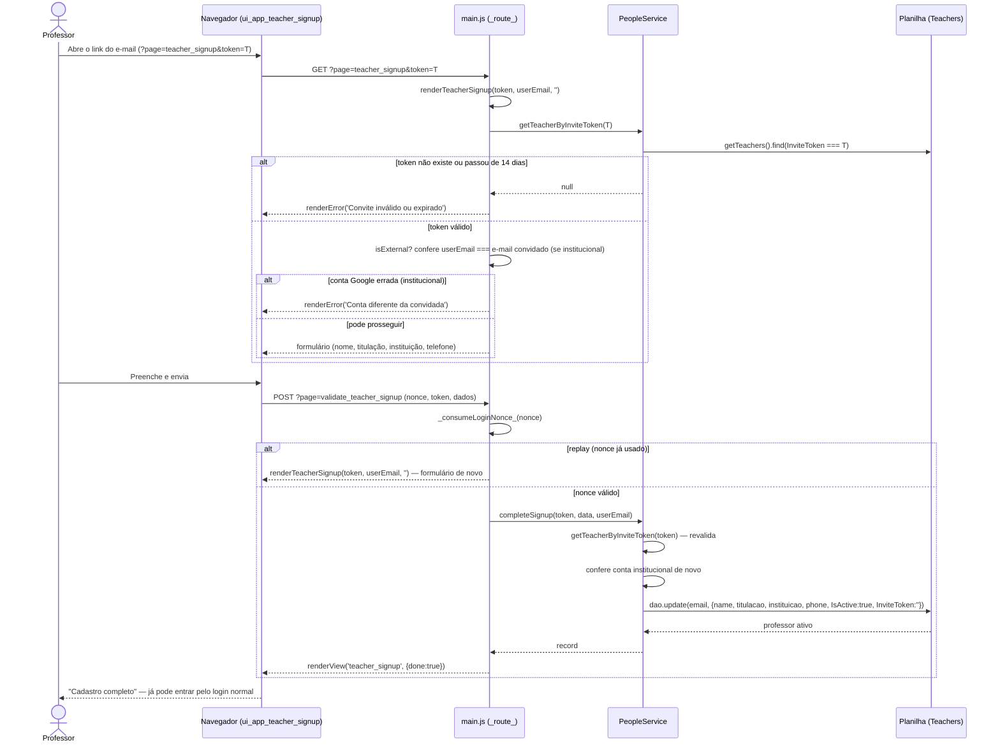

# Professor Completa o Próprio Cadastro — Cadeia de Chamadas

Chegada pelo link do convite (`?page=teacher_signup&token=...`). Em conta
institucional, a conta Google logada precisa ser a convidada — sem isso, um
link encaminhado deixaria outra pessoa assumir o cadastro.

Fontes: `src/main.js` (`_route_`, páginas `teacher_signup`/
`validate_teacher_signup`, `renderTeacherSignup`), `src/ServicePeople.js`
(`PeopleService.getTeacherByInviteToken`, `completeSignup`).

## Notas

- O token é de uso único: `completeSignup` o zera na mesma escrita que ativa a
  pessoa.
- Duas checagens da mesma regra (conta institucional == convidada): uma em
  `renderTeacherSignup` (feedback imediato) e outra dentro de
  `completeSignup` (a que vale de fato) — uma checagem que só existe na
  renderização não é checagem nenhuma.
