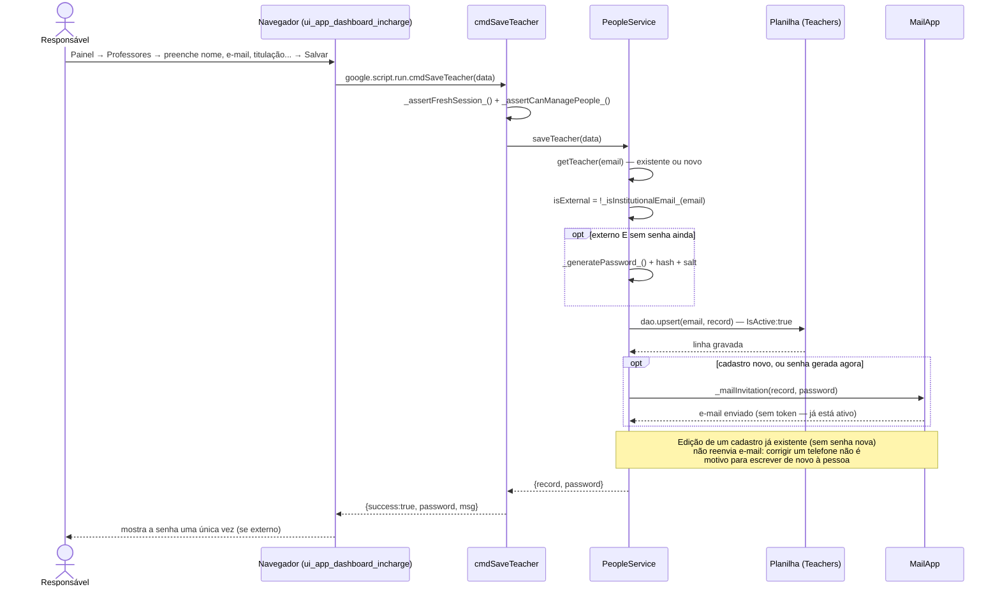

# Cadastro Direto de Professor — Cadeia de Chamadas

O Responsável digita tudo, e o professor já nasce **ativo** — sem convite, sem
espera. Útil para quem ele conhece de cor. O tipo de acesso (institucional ou
externo) é deduzido do domínio do e-mail, nunca perguntado — ver
[rationale 3.2](../rationale.md#32-isexternal-é-deduzido-do-domínio-não-perguntado).

Fontes: `src/ui_app_dashboard_incharge.html` (`saveTeacher`),
`src/ServiceSetup.js` (`cmdSaveTeacher`), `src/ServicePeople.js`
(`PeopleService.saveTeacher`, `_mailInvitation`).

## Notas

- Diferença para o convite (
  [06-convite-professor-email.md](06-convite-professor-email.md)): aqui não há
  `InviteToken` nem `IsActive:false` — a pessoa nasce pronta para uso, porque
  quem digitou os dados já é quem tinha autoridade para decidir.
