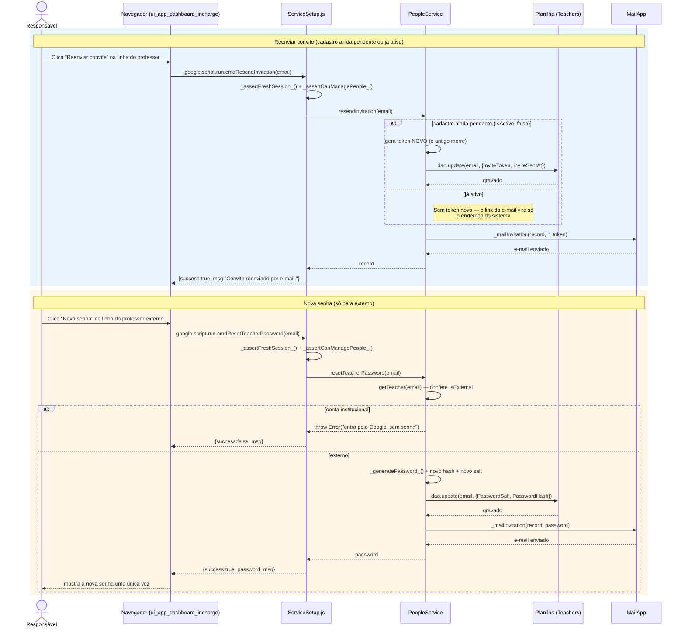

# Reenvio de Convite e Nova Senha — Cadeia de Chamadas

Dois gestos distintos, ambos no painel de Professores. Nenhum dos dois reexibe
a senha antiga: só o hash fica guardado, então "recuperar" não existe — só
substituir.

Fontes: `src/ui_app_dashboard_incharge.html` (`resendInvitation`,
`resetTeacherPassword`), `src/ServiceSetup.js` (`cmdResendInvitation`,
`cmdResetTeacherPassword`), `src/ServicePeople.js`
(`PeopleService.resendInvitation`, `resetTeacherPassword`).

