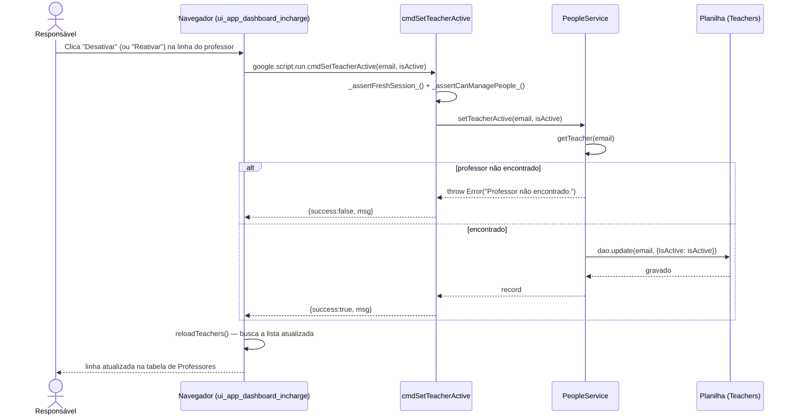

# Ativar / Desativar Professor — Cadeia de Chamadas

Nada é apagado — a pessoa pode estar nomeada numa banca de período anterior, e
uma linha ausente deixaria esse registro apontando para ninguém. Ver
[rationale 3.3](../rationale.md#33-ninguém-é-apagado-só-desativado).

Fontes: `src/ui_app_dashboard_incharge.html` (`toggleTeacher`),
`src/ServiceSetup.js` (`cmdSetTeacherActive`), `src/ServicePeople.js`
(`PeopleService.setTeacherActive`).

## Notas

- Passa por `setTeacherActive` diretamente, não por `saveTeacher`: esse outro
  caminho gera senha para um externo que ainda não tem uma, e simplesmente
  reativar alguém poderia mandar uma credencial nova sem necessidade.
- Um professor desativado some de `getTeacherEmails_()` (filtra por
  `IsActive`), então `AuthService._rolesInSemester` deixa de conceder
  Orientador a ele — a pessoa não entra mais como professor em período nenhum,
  mesmo mantendo a linha em `Teachers`. Se também for aluno ou Responsável
  noutro período, esses papéis continuam valendo.
