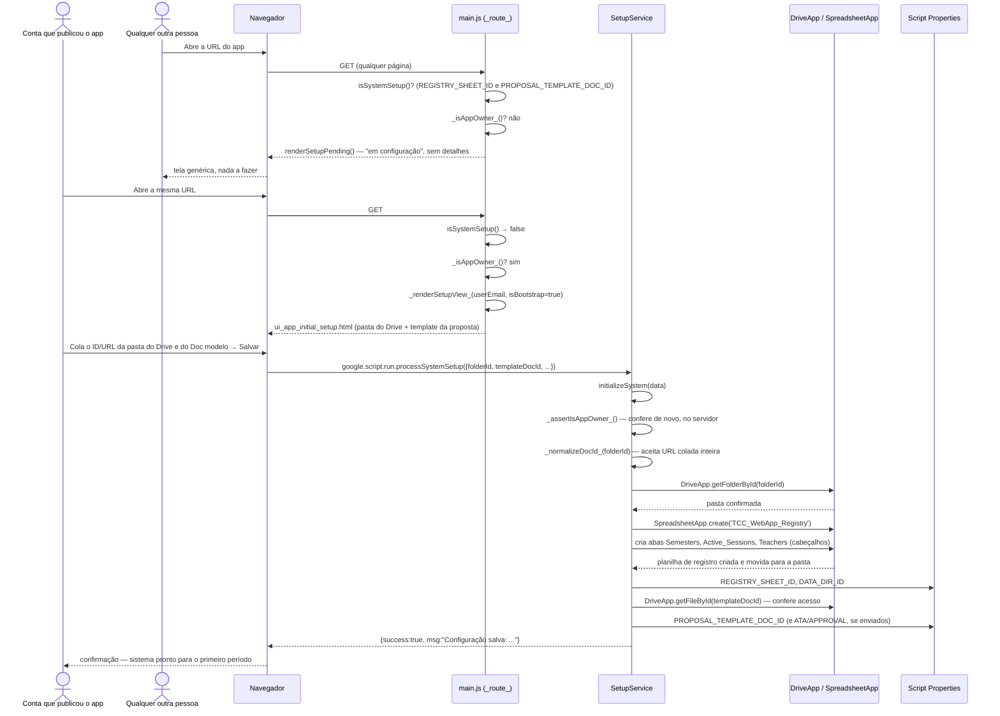

# Configuração Inicial do Sistema (Bootstrap) — Cadeia de Chamadas

O primeiro app dos "três apps em um" (ver [arch.md](../arch.md), "Três apps em
um"). Só a conta que publicou o Web App (`_isAppOwner_`) chega até aqui —
qualquer outra pessoa vê "Sistema em configuração" e nada mais, nem o que
falta. Cria o registro (planilha-mãe) e grava o template da proposta.

Fontes: `src/main.js` (`_route_`, trecho `!isSystemSetup()`, `_renderSetupView_`,
`renderSetupPending`), `src/ServiceSetup.js` (`_isAppOwner_`,
`processSystemSetup`, `SetupService.initializeSystem`).

## Notas

- `initializeSystem` é idempotente na parte da planilha: se o registro já
  existe, não recria — só grava os templates que vieram preenchidos. Campo em
  branco mantém o valor atual (relevante em
  [13-configuracao-sistema-revisitavel.md](13-configuracao-sistema-revisitavel.md)).
- Depois de `isSystemSetup()` virar verdadeiro, falta ainda um período letivo
  — ver [14-configuracao-periodo-letivo-bootstrap.md](14-configuracao-periodo-letivo-bootstrap.md).
