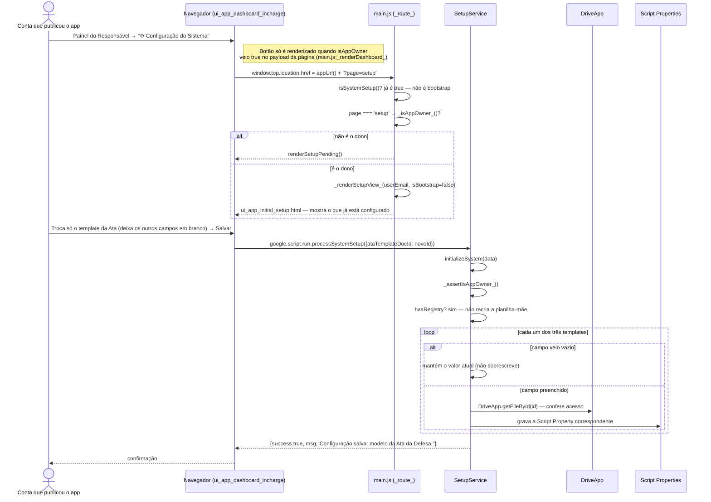

# Configuração do Sistema Revisitável — Cadeia de Chamadas

A mesma tela do bootstrap ([12](12-configuracao-inicial-sistema.md)), alcançada
de propósito depois de o sistema já estar rodando — `?page=setup`. Sem esta
rota, configurar os templates da Ata e da Folha de Aprovação (que chegam
**depois** do template da proposta) significaria editar Script Properties à
mão no editor do Apps Script.

Fontes: `src/main.js` (`_route_`, trecho `page === 'setup'`,
`_renderSetupView_`), `src/ui_app_dashboard_incharge.html`
(`openSystemSetup`), `src/ServiceSetup.js` (`processSystemSetup`,
`initializeSystem`).

## Notas

- `isSystemSetup()` só olha `REGISTRY_SHEET_ID` e `PROPOSAL_TEMPLATE_DOC_ID` —
  os templates da Fase 4 (Ata, Folha de Aprovação) são cobrados só na hora de
  gerar o documento (`_requireTemplate_`, ver
  [30-emitir-pdf-ata-folha-aprovacao.md](30-emitir-pdf-ata-folha-aprovacao.md)),
  não travam o resto do sistema — ver
  [rationale 6.3](../rationale.md#63-os-modelos-da-fase-4-não-entram-em-issystemsetup).
