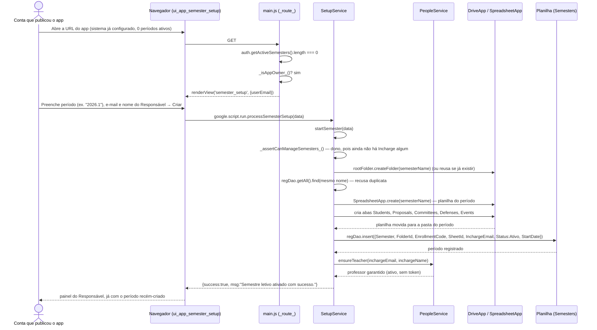

# Configuração do Primeiro Período Letivo (Bootstrap) — Cadeia de Chamadas

Alcançada quando o sistema já está configurado (Camada 1 concluída) mas **não
existe nenhum período `Ativo`** ainda. Sem esta guarda, qualquer pessoa que
chegasse antes do Responsável criaria um período — e, como criar não desativa
os outros, isso por si só não derrubaria nada, mas criaria lixo sem
`InchargeEmail` correto.

Fontes: `src/main.js` (`_route_`, trecho `getActiveSemesters().length === 0`),
`src/ui_app_semester_setup.html`, `src/ServiceSetup.js`
(`processSemesterSetup`, `SetupService.startSemester`).

## Notas

- `ensureTeacher` é o que faz "o Responsável é também Orientador" valer desde
  o primeiro período — sem ele, o bootstrap ficaria travado (ninguém pode
  cadastrar professor antes de existir período). Ver
  [rationale 2.5](../rationale.md#25-o-responsável-do-período-é-cadastrado-como-professor-ao-criar-o-período).
- O mesmo `startSemester` é reaproveitado de dentro do app — ver
  [15-criar-periodo-letivo.md](15-criar-periodo-letivo.md), que muda só a
  guarda de quem pode chamar.
