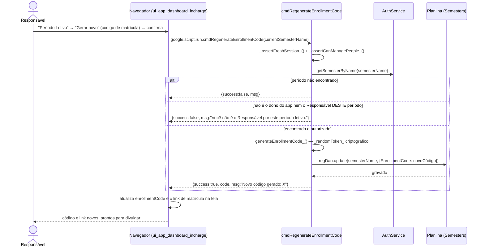

# Regenerar Código de Matrícula — Cadeia de Chamadas

Gerar outro código invalida o anterior na hora — o uso é justamente esse,
quando o código vaza para fora da turma.

Fontes: `src/ui_app_dashboard_incharge.html` (`regenerateCode`),
`src/ServiceSetup.js` (`cmdRegenerateEnrollmentCode`), `src/ServicePeople.js`
(`generateEnrollmentCode_`).

## Notas

- O link de matrícula (`?page=enrollment&code=...`) muda junto, porque é
  montado a partir do mesmo `enrollmentCode` — não há dois lugares para
  atualizar.
- Não devolve `dashboard` recalculado porque a mudança não afeta a tabela
  mestra de alunos, só o código exibido no painel de Período Letivo.
- `cmdRegenerateEnrollmentCode` continua atrás de `_assertCanManagePeople_()`
  (Responsável, ou dono do app): o Orientador só **lê** o código, na guia
  "Convite aos Alunos" (`getAdvisorDashboardData`) — ver
  [features/dashboard-advisor.md](../features/dashboard-advisor.md#convite-aos-alunos).
  Deixar qualquer Orientador regenerar invalidaria o código para o período
  inteiro por uma decisão de uma só pessoa.
