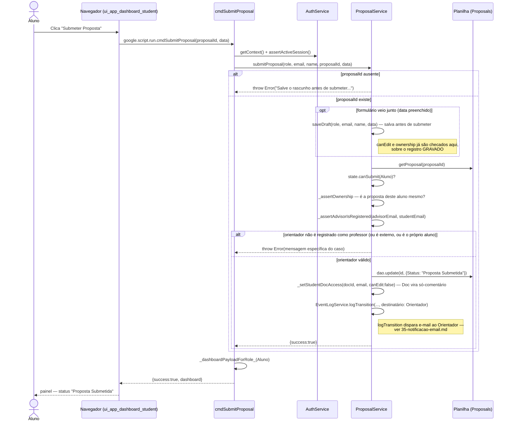

# Submeter Proposta — Cadeia de Chamadas

Editar um campo e clicar em Submeter costumava descartar a edição em
silêncio — o aluno tinha de lembrar de salvar antes. Agora `submitProposal`
salva primeiro (implícito) e submete na mesma chamada: uma falha não deixa
nada meio-aplicado.

Fontes: `src/ui_app_dashboard_student.html` (`submitProposal`),
`src/ServiceProposal.js` (`cmdSubmitProposal`, `ProposalService.submitProposal`,
`_assertAdvisorIsRegistered`).

## Notas

- O gate do orientador registrado é em **SUBMIT**, não em `saveDraft`: o
  rascunho é o que cria o Doc, e o aluno precisa dele para escrever enquanto o
  orientador ainda está sendo cadastrado pelo Responsável.
