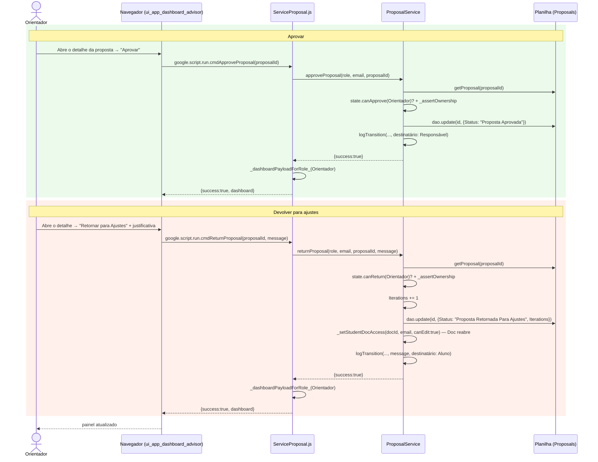

# Orientador Aprova ou Devolve a Proposta — Cadeia de Chamadas

As duas decisões do Orientador sobre uma proposta `Submetida`. Devolver conta
uma iteração (para medir o vai e vem) e reabre o Doc para edição; aprovar
encaminha ao Responsável para homologação.

Fontes: `src/ui_app_dashboard_advisor.html` (`approveProposal`,
`returnProposal`), `src/ServiceProposal.js` (`cmdApproveProposal`,
`cmdReturnProposal`, `ProposalService.approveProposal`, `returnProposal`).

## Notas

- O ciclo submeter → devolver → ajustar → ressubmeter pode se repetir várias
  vezes; `Iterations` conta cada devolução, e é essa contagem que documenta o
  vai e vem no registro de atividades (não há limite de rodadas no código).
