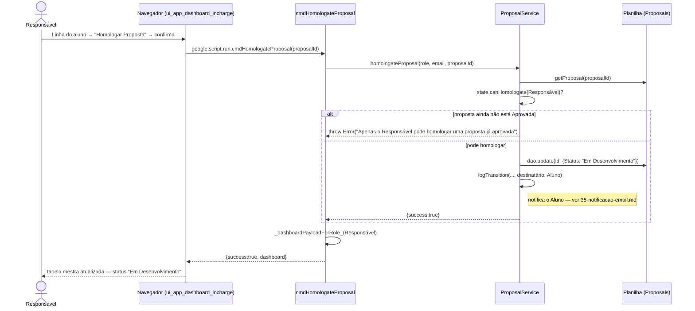

# Homologar Proposta — Cadeia de Chamadas

Ato do Responsável sobre uma proposta já `Aprovada` pelo Orientador. Não existe
um estado de repouso "Proposta Homologada" — homologar já move o aluno direto
para `Em Desenvolvimento`.

Fontes: `src/ui_app_dashboard_incharge.html` (`homologateProposal`),
`src/ServiceProposal.js` (`cmdHomologateProposal`,
`ProposalService.homologateProposal`).

## Notas

- Homologação é ato **global** do Responsável: ao contrário de aprovar (que
  exige ser o orientador *daquela* proposta), não há checagem de propriedade
  aqui — o papel Responsável já basta.
