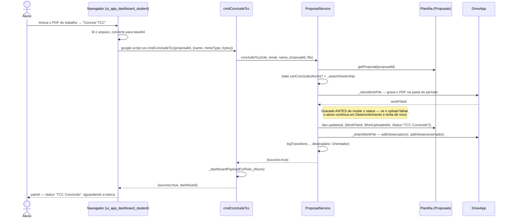

# Concluir Desenvolvimento — Cadeia de Chamadas

O aluno encerra a Fase 2 enviando o trabalho (PDF), que a partir daqui
pertence ao app — é o que permite ao sistema compartilhá-lo com a banca sozinho
quando ela for homologada, sem passo manual do aluno.

Fontes: `src/ui_app_dashboard_student.html` (`concludeTcc`),
`src/ServiceProposal.js` (`cmdConcludeTcc`, `ProposalService.concludeTcc`,
`_storeWorkFile`, `_shareWorkFile`).

## Notas

- `_shareWorkFile` só compartilha com o **Aluno** e o **Orientador** — os
  únicos dois papéis cujo painel chega a mostrar o link do trabalho
  (`workFileLinkHtml`, em `ui_scripts.html`). Os membros da banca nunca
  recebem acesso a este arquivo bruto; o que eles veem depois é a Ata e a
  Folha de Aprovação em PDF, documentos próprios montados a partir de
  template — ver [30-emitir-pdf-ata-folha-aprovacao.md](30-emitir-pdf-ata-folha-aprovacao.md).
