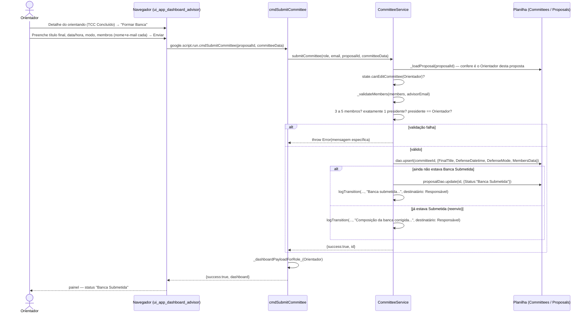

# Orientador Submete a Formação da Banca — Cadeia de Chamadas

O Orientador monta a banca (3 a 5 membros, ele presidente) depois de o aluno
concluir o Desenvolvimento. Reenviar enquanto ainda não homologada é correção,
não nova submissão — não existe devolução da banca pelo Responsável.

Fontes: `src/ui_app_dashboard_advisor.html` (`submitCommittee`),
`src/ServiceCommittee.js` (`cmdSubmitCommittee`,
`CommitteeService.submitCommittee`, `_validateMembers`).

## Notas

- Nenhum membro é convidado aqui — o convite automático só acontece na
  **homologação**, quando a banca deixa de ser proposta e vira compromisso.
  Ver [24-homologar-banca.md](24-homologar-banca.md).
