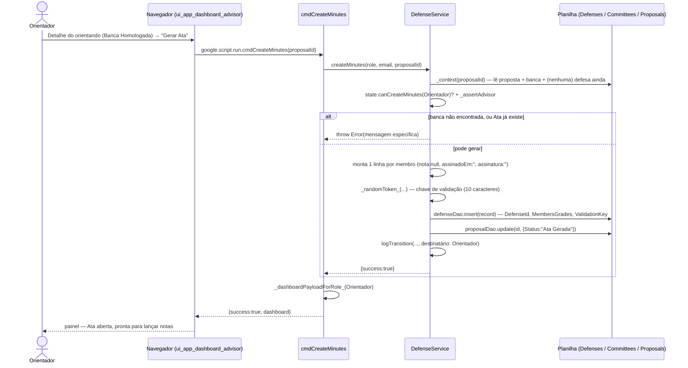

# Gerar a Ata — Cadeia de Chamadas

O Orientador abre a Ata depois de a banca ser homologada. A defesa em si
acontece fora do sistema; o que nasce aqui é o registro que colhe notas e
assinaturas — com a composição da banca **congelada** no momento da criação, e
a chave de validação que vai impressa nos dois PDFs.

Fontes: `src/ui_app_dashboard_advisor.html` (`createMinutes`/`cmdCreateMinutes`),
`src/ServiceDefense.js` (`_executeDefenseCommand_`, `DefenseService.createMinutes`).

## Notas

- A composição da banca fica congelada aqui: `MembersData` é copiado da banca
  no instante da criação, então uma alteração posterior na banca (não há tela
  para isso depois de homologada) não mudaria quem assina.
- Próximo passo: [26-lancar-notas-assinar-orientador.md](26-lancar-notas-assinar-orientador.md).
