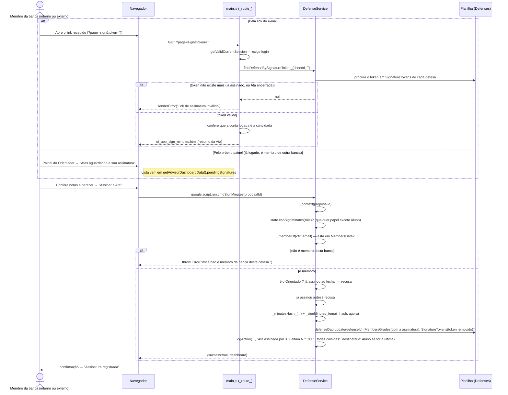

# Assinar como Membro da Banca — Cadeia de Chamadas

Autorização por **pertencimento**, não por papel: quem assina está em
`MembersData`. Um professor que não orienta este aluno e um convidado externo
entram os dois como Orientador (é o único papel que a UFAM concede a quem
está em `Teachers`) — o que distingue é a lista de membros, não o papel.

Duas portas para o mesmo comando: o link do e-mail (qualquer membro) ou o
bloco "Atas aguardando a sua assinatura" no próprio painel (quem já tem conta
no sistema).

Fontes: `src/main.js` (`_route_`, página `sign`, `renderSignMinutes`),
`src/ui_app_sign_minutes.html`, `src/ui_app_dashboard_advisor.html`
(`pendingSignatures`), `src/ServiceDefense.js` (`cmdSignMinutes`,
`findDefenseBySignatureToken_`, `DefenseService.signAsMember`).

## Notas

- O token é de uso único: `signAsMember` o remove de `SignatureTokens` na
  mesma escrita que grava a assinatura — reabrir o link depois dá "link
  inválido", que é o caminho normal, não um erro.
- Quando a última assinatura da banca é colhida, o destinatário da notificação
  vira o Aluno — é a vez dele dar o "de acordo". Ver
  [28-de-acordo-aluno.md](28-de-acordo-aluno.md).
