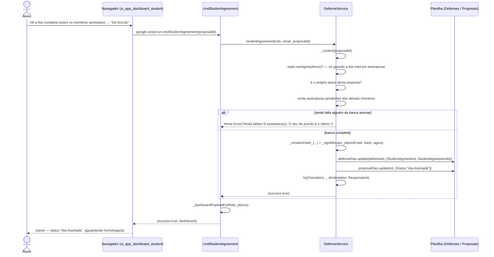

# De Acordo do Aluno — Cadeia de Chamadas

A última assinatura da Ata, e a única do Aluno. Vale ao mesmo tempo para a Ata
e para a Folha de Aprovação — é o mesmo consentimento, e pedi-lo duas vezes
não acrescentaria nada.

Fontes: `src/ui_app_dashboard_student.html` (`studentAgreement`),
`src/ServiceDefense.js` (`cmdStudentAgreement`,
`DefenseService.studentAgreement`).

## Notas

- Esta é a assinatura que os dois PDFs (Ata e Folha de Aprovação) exigem para
  poderem ser emitidos — ver
  [30-emitir-pdf-ata-folha-aprovacao.md](30-emitir-pdf-ata-folha-aprovacao.md).
