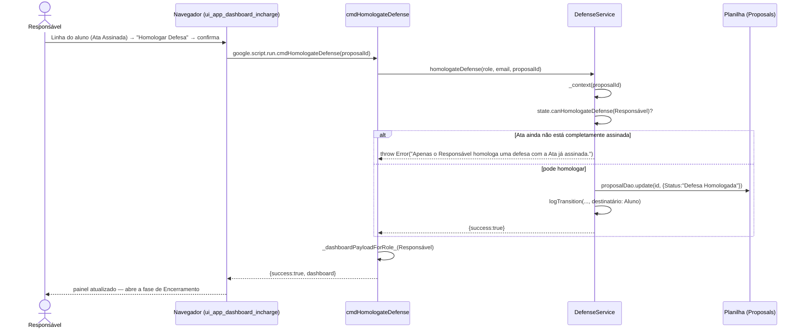

# Homologar Defesa — Cadeia de Chamadas

Fecha a Fase 4. A fase não se fecha sozinha quando a última assinatura chega —
o Responsável vê a Ata completa e homologa, ato administrativo que abre a
revisão e a entrega final para o aluno.

Fontes: `src/ui_app_dashboard_incharge.html` (`homologateDefense`),
`src/ServiceDefense.js` (`cmdHomologateDefense`,
`DefenseService.homologateDefense`).

## Notas

- A partir daqui o aluno já pode entregar a versão final e o comprovante do
  RIU — ver [31-entrega-final-riu-pdf.md](31-entrega-final-riu-pdf.md).
