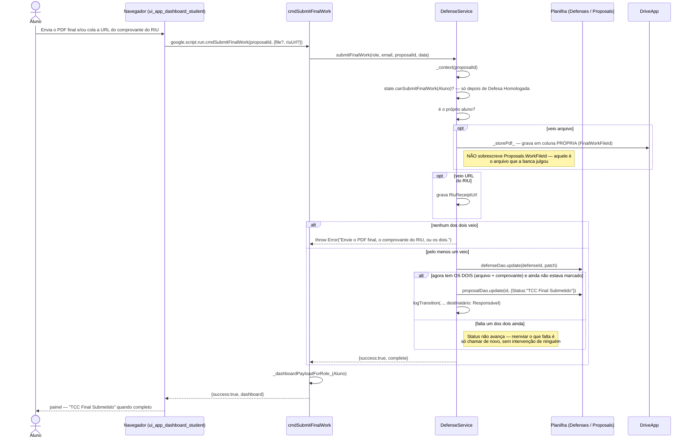

# Entrega Final (RIU + PDF) — Cadeia de Chamadas

O aluno entrega em duas partes independentes — a versão final em PDF e o
comprovante de submissão no RIU — que podem chegar em momentos diferentes. O
status só avança quando **as duas** existem.

Fontes: `src/ui_app_dashboard_student.html` (`submitFinalWork`),
`src/ServiceDefense.js` (`cmdSubmitFinalWork`,
`DefenseService.submitFinalWork`).

## Notas

- Reenviar continua liberado mesmo depois de completo, enquanto o Responsável
  não finalizar: trocar um arquivo errado não deveria exigir intervenção de
  ninguém.
