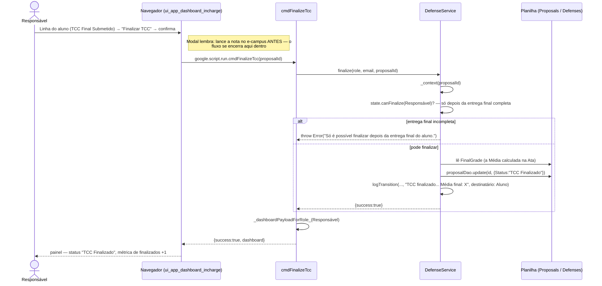

# Finalizar TCC — Cadeia de Chamadas

Último passo do fluxo normal: o Responsável lança a nota (já calculada na Ata)
no e-campus e fecha o TCC no sistema. Aqui o fluxo se encerra — não há mais
nada a fazer depois disso.

Fontes: `src/ui_app_dashboard_incharge.html` (`finalizeTcc`),
`src/ServiceDefense.js` (`cmdFinalizeTcc`, `DefenseService.finalize`).

## Notas

- `FinishedState` é fim de linha: nem `canCloseWithoutDefense` (que normalmente
  vale em qualquer status para o Responsável) funciona depois disto — ver
  [33-encerrar-sem-banca.md](33-encerrar-sem-banca.md).
