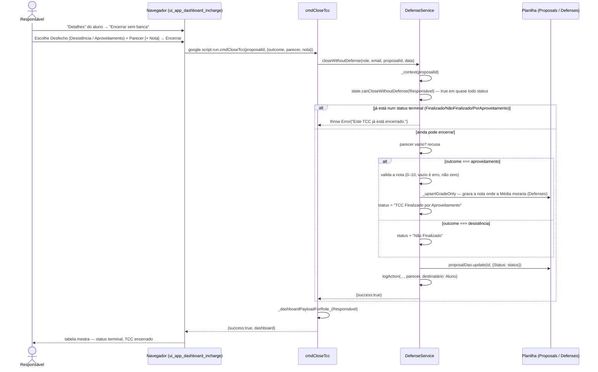

# Encerrar Sem Banca (Aproveitamento / Desistência) — Cadeia de Chamadas

Os dois fluxos alternativos de `specs.md`. Disponível em **qualquer status não
terminal**, porque é isso que o caso pede: um aluno desiste quando desiste, e
um aproveitamento pode chegar antes da primeira proposta. Fica no "Detalhes",
não na coluna de ações — é exceção, não passo do fluxo.

Fontes: `src/ui_app_dashboard_incharge.html` (`closeTcc`, `closePanelHtml`),
`src/ServiceDefense.js` (`cmdCloseTcc`, `DefenseService.closeWithoutDefense`,
`_upsertGradeOnly`), `src/ServiceTccState.js` (`TccState.canCloseWithoutDefense`
— na classe base, não numa subclasse).

## Notas

- `canCloseWithoutDefense` mora na classe **base** `TccState`, não numa
  subclasse — é a única permissão que vale independente do estado atual, e por
  isso é a única desligada explicitamente nos estados terminais
  (`FinishedState.canCloseWithoutDefense` retorna `false`).
- Campo de nota vazio é barrado **antes** da conversão numérica:
  `Number('')` é `0`, não `NaN` — sem essa guarda, "esqueci de digitar" viraria
  silenciosamente "nota zero".
