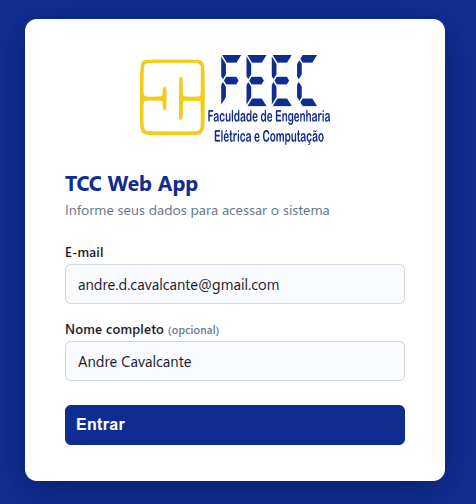

# TCC Web App - Funcionalidades - Login

## Porta única de entrada: conta Google autenticada

Antes das duas portas abaixo há uma condição que vale para todo mundo, sem
exceção: **é preciso estar logado numa conta Google**. Qualquer uma — não
precisa ser `@ufam.edu.br`, e nem precisa ser o e-mail do cadastro. O membro
externo entra com o Gmail pessoal que tiver e, aí sim, informa o e-mail e a
senha que recebeu.

Duas coisas garantem isso, e são deliberadamente redundantes:

1. A implantação é publicada como **"qualquer pessoa com conta Google"**
   (`webapp.access: ANYONE` no `appsscript.json`; o valor que abriria para
   visitante anônimo é `ANYONE_ANONYMOUS`).
2. `_requireGoogleIdentity_()` (`ServiceAuth.js`) recusa a requisição quando não
   há chave de identidade, e o roteador checa isso antes de qualquer outra
   coisa. Uma decisão de autorização não pode depender de uma configuração de
   implantação: a configuração do manifesto vale para implantações **novas**, e
   uma já publicada conserva o que foi escolhido na interface quando nasceu.

O que essa guarda fecha está em
[rationale 1.1](../rationale.md#11-conta-google-é-obrigatória-mas-não-precisa-ser-institucional).

Consequência a comunicar a quem for convidado para banca: quem não tiver conta
Google nenhuma precisa criar uma (gratuita) antes da defesa. A conta serve só
para provar que o visitante é *alguém*; quem ele é continua sendo decidido pelo
e-mail e pela senha do cadastro.

## Duas portas, porque há duas naturezas de conta

A tabela de pessoas é a **única** validação de quem é quem, o que torna
essencial separar identidade *provada* de identidade *alegada*:

| Situação | Como entra |
| :--- | :--- |
| Conta que o Google identifica (`@ufam.edu.br`) | Sem senha. O campo de e-mail é somente leitura |
| Conta que o Google **não** identifica (membro externo de banca) | E-mail **e senha**, conferidos contra a aba `Teachers` — no máximo 8 tentativas erradas por conta Google, depois 15 min de espera |

- Para contas do domínio, `Session.getActiveUser().getEmail()` resolve e **o
  Google já provou quem é**. Guardar senha para essas contas seria trocar uma
  autenticação forte por uma mais fraca, mantida por nós, com recuperação e
  superfície de vazamento próprias.
- Para qualquer outra conta essa chamada devolve `''` — restrição de
  plataforma, não bug. O e-mail digitado passa a ser uma **alegação não
  verificada**, e por isso só vale acompanhado da senha gerada no cadastro.

**O que mudou em relação ao login anterior**: o e-mail digitado era aceito
sozinho, com cache em `localStorage`, e qualquer um podia se declarar qualquer
pessoa que estivesse no roster. O cache do e-mail foi removido (o do *nome*
ficou — é só rótulo de exibição). Ver `roadmap.md`, "Restrição de login a contas
ufam.edu.br".

## Primeiro acesso do aluno: código do período

Quem não tem papel em nenhum período **não recebe uma tela de erro** — um aluno
no primeiro acesso é *suposto* ser desconhecido. A tela de auto-cadastro
(`?page=enrollment`) pede o código do período letivo, o nome completo, a
matrícula e o telefone.

O código (`Semesters.EnrollmentCode`) é divulgado pelo Responsável no Plano de
Ensino, e concede **apenas** o papel `ALUNO`. Professor nunca entra por aqui:
auto-cadastro que concedesse `ORIENTADOR` seria escalação de privilégio.

O alfabeto do código não tem `I`, `O`, `0` nem `1` — ele é lido numa tela ou num
papel e digitado à mão, e um caractere ambíguo produz um aluno que não consegue
se matricular e não tem como saber por quê.

## Sessão e replay

- A entrada dispara um tempo de sessão configurável (5 min), de modo que um F5
  não obriga a repetir o login. Vale também para contas fora do domínio: a
  sessão é indexada por uma chave de identidade estável por usuário+script
  (`Session.getTemporaryActiveUserKey()`, usada quando o e-mail não resolve —
  ver "Identidade de Sessão" em `data-structure.md`), disponível em toda
  execução do servidor, inclusive num F5 sem nenhum dado de formulário.
- Passado esse tempo **sem interação**, qualquer nova entrada de página (F5
  incluído) volta à tela de login. O mesmo prazo vale para os **comandos de
  escrita** (`assertActiveSession`); as *leituras* de painel seguem tolerantes —
  ver [rationale 1.6](../rationale.md#16-o-timeout-de-sessão-vale-para-escritas-não-só-para-navegação). Duas armadilhas de replay já apareceram
  aqui, ambas fechadas: a submissão do login, resolvida com um token de uso
  único, e a URL da troca de papel (`?page=switch_role&...`), resolvida
  aplicando a troca só **depois** da checagem de timeout. As duas têm a mesma
  origem — a requisição fica reproduzível pelo navegador. Nenhum efeito
  colateral sobre a sessão pode acontecer antes dessa checagem.
- **O formulário é `POST`** (`doPost` em `main.js`, delegando ao mesmo roteador
  do `doGet`). Com o `GET` anterior, os dados digitados ficavam na barra de
  endereços e no histórico, sobrevivendo à sessão — e agora haveria uma senha
  entre eles. Critério geral do projeto: dado do usuário não trafega por GET;
  `?page=` continua GET, porque seleção de visão é o uso legítimo da query
  string. O `target="_top"` escapa do iframe do Apps Script, permitido por ser
  clique real do usuário (`allow-top-navigation-by-user-activation`).

## Modo de teste

`Session.getActiveUser()` só resolve contas do domínio do script, então testar o
papel de **Aluno** exigiria uma segunda conta `@ufam.edu.br` real. A Script
Property `TEST_LOGIN_ENABLED=true` libera o auto-cadastro para uma conta que o
Google não identifica (uma Gmail de teste, por exemplo).

Ela **não reabre o buraco**: mesmo ligada, o cadastro recusa qualquer e-mail que
já pertença a um professor cadastrado. O pior que consegue produzir é um aluno
falso — nunca um orientador falso. Deve ficar desligada na implantação real.

## Resumo do roteamento

| Condição | Destino |
| :--- | :--- |
| Setup pendente | `ui_app_initial_setup.html` |
| Conta sem papel em nenhum período | `ui_app_enrollment.html` (auto-cadastro por código) |
| Senha inválida (conta não identificada pelo Google) | `ui_error.html` |
| Código de período inválido | `ui_app_enrollment.html`, com a mensagem |
| Perfil: Aluno (`UserRole.STUDENT`) | `ui_app_dashboard_student.html` |
| Perfil: Orientador (`UserRole.ADVISOR`) | `ui_app_dashboard_advisor.html` |
| Perfil: Responsável (`UserRole.INCHARGE`) | `ui_app_dashboard_incharge.html` |

## Implementação

| Arquivo | Papel |
| --- | --- |
| `ServiceAuth.js` | `processLogin` (as duas portas), `processEnrollment` (código do período), `_rolesInSemester` (papéis a partir das tabelas), `_unverifiedLoginAllowed_` (modo de teste) |
| `ServicePeople.js` | `verifyPassword`, `enrollStudent`, hash salgado e geração de senha |
| `main.js` | Rotas `validate_login`, `enrollment` e `validate_enrollment`; `renderLogin`/`renderEnrollment` |
| `ui_app_login.html` | Campo de e-mail travado ou editável+senha, link para o auto-cadastro |
| `ui_app_enrollment.html` | Tela de primeiro acesso do aluno |
