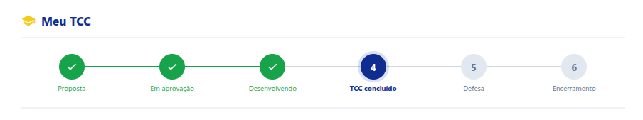

# TCC Web App — Especificações

O que o sistema faz e por quais regras. Documentos irmãos:

| Documento | Para quê |
| --- | --- |
| [arch.md](arch.md) | Como está construído: camadas, visões, serviços |
| [rationale.md](rationale.md) | **Por que** cada escolha foi feita, e o que dava errado do outro jeito |
| [data-structure.md](data-structure.md) | Planilhas, abas, colunas e status |
| [checkpoint.md](checkpoint.md) | Estado atual e o que falta |
| [roadmap.md](roadmap.md) | O que ainda não existe, e como já foi decidido |
| [setup-dev.md](setup-dev.md) | Montar o ambiente de desenvolvimento |
| [deploy-joomla.md](deploy-joomla.md) | Publicar o app em `feec.ufam.edu.br/tccweb` |
| [features/](features/) | Cada funcionalidade em detalhe |

## O que é o sistema

TCC Web App é um **Web App (Google Apps Script)** que permite o acompanhamento e a automação do processo de elaboração dos TCCs na disciplina Projeto de Final de Curso (PFC) da Faculdade de Engenharia Elétrica e de Computação (FEEC) da Universidade Federal do Amazonas (UFAM).

> As pessoas do processo — alunos, professores e convidados de banca — vivem em
> tabelas do próprio sistema. Ver [rationale 3.1](rationale.md#31-o-google-classroom-saiu).

Há três papéis no sistema:

- **Responsável**: o professor responsável pela disciplina PFC no período letivo
  (é o `InchargeEmail` da linha daquele período). É **também** Orientador: criar
  o período o cadastra como professor.
- **Orientador**: qualquer professor cadastrado pelo Responsável — por convite
  individual por e-mail, ou digitado direto por ele. O cadastro atravessa
  períodos: cadastra-se uma vez. Não há auto-cadastro de professor, porque ter
  e-mail institucional não prova ser professor: alunos também têm. Se a pessoa
  também for Responsável naquele período, terá acesso às duas visões.
- **Aluno**: aluno matriculado no período, por auto-cadastro com o código do período letivo.

## Login

O sistema é acessado por uma URL única no browser.

**Estar logado numa conta Google é pré-requisito de todo mundo.** Qualquer uma —
não precisa ser institucional, nem ser o e-mail do cadastro. A partir daí há duas
portas:

| Situação | Como entra |
| --- | --- |
| A conta é do domínio da instituição | Sem senha: o Google já provou quem é |
| A conta é de fora | O e-mail digitado é uma alegação, e só vale com a senha gerada no cadastro |

Os papéis são determinados consultando as tabelas de pessoas (`Teachers`, no
registro, e `Students`, no período). Uma pessoa pode ter mais de um papel no
mesmo período, e troca de visão pelo seletor do cabeçalho.

Reentrada (um F5) dentro de 5 minutos não pede os dados de novo; passado esse
tempo sem interação, pede. A validação é reaproveitada por até esse mesmo prazo,
sem nova consulta aos cadastros a cada chamada. Mudanças de sessão, cadastro ou
período feitas pelo sistema invalidam a validação correspondente; uma função
interna permite forçar nova leitura. Painéis e comandos recusam sessões
expiradas. Ver [features/login.md](features/login.md) e
[cache e acesso a dados](arch.md#cache-e-acesso-a-dados).

## Fluxo do PFC

> Cada aluno tem **um único status**, que evolui por todas as fases abaixo
> (de *Sem Proposta* a *TCC Finalizado*). Os nomes em negrito ao longo deste
> fluxo são exatamente os valores desse status — ver a seção "Status Único"
> em `data-structure.md`.

- Aluno entra no período letivo pelo **código do período** ou pelo **link de
  matrícula** que o carrega, ambos divulgados pelo Responsável através do Plano
  de Ensino (disponível via E-campus, o sistema de gestão acadêmica da UFAM). No
  primeiro acesso ele declara nome, matrícula e contato.

- O Plano de Ensino leva também a URL do TCC-WebApp e o manual do fluxo.

- Ao entrar no sistema o aluno recebe o Status de **Sem Proposta** e vê, na sua visão, todo este fluxo de forma icônica numa barra de topo e, abaixo, as ações e formulários de acordo com o seu status.

Exemplo:

- Fluxo:
  1. Proposta de Projeto (há um subfluxo aqui):

     1. Aluno edita a sua proposta; ao salvar pela primeira vez, o sistema gera automaticamente o Google Doc da proposta (a partir do template) e o status do aluno vai para **Proposta Em Elaboração**. O conteúdo rico (Resumo/Objetivos/Metodologia/Referências) é editado diretamente nesse Doc — o formulário do app cuida só dos dados estruturados (Título, Matrícula, contatos, cronograma).
     2. Aluno submete a sua proposta; o status vai para **Proposta Submetida** (Proposta Em Aprovação).
     3. O Orientador pode retornar a proposta para ajustes; status: **Proposta Retornada Para Ajustes**. A justificativa fica registrada numa linha do tempo de anotações (visível ao Aluno, ao Orientador e, como indicador rápido, ao Responsável), além dos comentários nativos do próprio Google Doc.
     4. Se retornou o aluno atualiza e precisa ressubmeter (podendo deixar sua própria anotação na mesma linha do tempo); ao ressubmeter o status vai para **Proposta Submetida** (Proposta Em Aprovação) novamente. O ciclo pode se repetir várias vezes. Deve-se contar o número de intereções.
     5. Se está tudo certo, o Orientador Aprova e o status é **Proposta Aprovada**
     6. Se a proposta está aprovada, ao Responsável é liberada a ação de homologar. Ao homologar a proposta vai para **Proposta Homologada** e o aluno passa a fase de Desenvolvimento do TCC; status do TCC: **Em Desenvolvimento**

  2. Desenvolvimento do TCC: no desenvolvimento, o aluno vai realizar o que foi proposto de acordo com a orientação de seu orientador. Ao final, o aluno clica na ação Conlcui o TCC para finalizar esta fase e entrar na fase da Formação da Banca; status **TCC Concluído**

  3. Formação da Banca (há um subfluxo aqui):

     1. O Orientador vai na sua visão, clica em Formação da Banca, preenche os dados com os nome dos participantes da banca, dia, hora e como vai ser (presencial, remoto ou híbrido) e submete ao Responsável; status **Banca Submetida**. Enquanto não homologada, o Orientador pode corrigir e reenviar os dados (o status não muda) — não há devolução da banca pelo Responsável.
     2. O Responsável, vendo o status **Banca Submetida**, visualiza a composição e pode homologar. Ao final, status **Banca Homologada** e o fluxo entra na fase de Defesa.

  4. Defesa (há um subfluxo aqui):

     1. Geração da ata: o Orientador pede, na sua lista de ações, para gerar a Ata da Defesa: após a homologação da banca, inclusive antes da defesa, fica disponível a ação **Ficha de apoio à defesa (PDF)**. Ela usa o modelo da Ata com os dados do aluno e da banca, sem assinaturas ou chave de validação, e espaços para anotar notas, média, parecer e observações. O Orientador imprime essa via de apoio e depois transcreve os resultados no sistema. Status: **Ata Gerada**
     2. Defesa: o aluno faz a sua defesa; o Orientador lança as observações da banca e as notas na Ata online e finaliza com a sua assinatura: **Ata Em Assinaturas**
     3. Assinaturas: cada membro da banca entra no sistema e assina a ata: **Ata Assinada Membro 1** e depois **Ata Assinada Membro 2**.
     4. De acordo do aluno: o aluno é o **último a assinar**, e a assinatura dele é um *de acordo* — status **Ata Assinada**. Na visão do aluno, as notas individuais são exibidas como **Membro 1**, **Membro 2** etc., em ordem crescente de nota, sem associação ao nome ou à ordem nominal da banca; a média permanece visível. A resposta enviada ao navegador não inclui a identificação do avaliador nas linhas de notas. As demais visões mantêm a identificação. Essa mesma assinatura vale para a Ata e para a Folha de Aprovação que ele anexa ao PDF final, logo após a folha de rosto: é o mesmo consentimento, e pedi-lo duas vezes não acrescentaria nada.
     5. Homologação: a fase não se fecha sozinha. O Responsável vê a Ata assinada por todos e homologa — um ícone no painel dele —, e é isso que leva o TCC ao Encerramento: status **Defesa Homologada**.
     6. Após a banca finalizada, a Ata vai poder ser baixada em formato PDF (se precisar podemos criar um template para isso), servindo de comprovação de participação para cada membro da banca. Ao aluno, também será possível baixar um PDF com a Folha de Aprovação (nome e a "assinatura" dos membros [se precisar, criamos um template para isso]), que ele insere na versão final do TCC logo após a folha de rosto. Ver "DOCUMENTOS EM PDF" na seção Dados.

  5. Encerramento (há um subfluxo aqui):

     1. Alterações: o aluno faz as alterações sugeridas pela banca, se necessário; o status não muda; as ações liberadas para o aluno são a Submissão no RIU e a Submissão da versão final do TCC em PDF;
     2. Submissão no RIU: o aluno faz o procedimento de submissão no Repositório Institucional da Universidade (RIU); para isso, o Orientador assina um documento dizendo que aquela é a versão final; após o envio, recebe o Comprovante de Submissão no RIU, então o aluno vai no sistema e submete este comprovante e a versão final do TCC em PDF; status: **TCC Final Submetido**
     3. Lançamento: o Responsável lança a nota do aluno (que está na ata) e finaliza o TCC: status **TCC Finalizado**

  > Encerrado o período letivo, **só o Responsável** reemite Ata e Folha de
  > Aprovação. Enquanto o período corre, cada membro da banca baixa a própria
  > Ata na área dele, e o aluno baixa a Folha de Aprovação na dele.
  >
  > **Ainda não implementado:** hoje um período encerrado fica inacessível para
  > todos, inclusive o Responsável. Ver [roadmap.md](roadmap.md#backlog).

### Fluxos Alternativos

1. Aproveitamento de Artigo: o aluno se matricula e então submete um aproveitamento ao responsável; se OK, o Responsável lança a nota e finaliza o TCC do Aluno com o status final: **TCC Finalizado por Aproveitamento**

2. O aluno desiste: o aluno pode nunca submeter uma proposta ou desiste da defesa: o Responsável então finaliza o TCC daquele aluno com o status final **Não Finalizado**

## Dados

### PROPOSTA DE PROJETO DE TCC

- Título do projeto
- Dados do aluno (nome, matrícula, e-mail, telefone)
- Dados do orientador (nome, e-mail e telefone)
- Cronograma (com data prevista para a defesa, pelo menos 15 dias antes do encerramento do período letivo)
- Resumo expandido, Objetivos, Metodologia e Referências: editados pelo aluno
  num **Google Doc próprio**, gerado a partir de um template configurado pelo
  Responsável no setup do sistema. O sistema guarda só o link do Doc, não o
  conteúdo — ver [rationale 6.1](rationale.md#61-o-conteúdo-rico-da-proposta-vive-num-google-doc).

### FORMAÇÃO DA BANCA

- Data da Defesa
- Hora da Defesa
- Modo da Defesa (Presencial, Remoto, Híbrido)
- Nome do Aluno
- Título Final do Trabalho
- Quantidade de membros
- Membro X da Banca: (mínimo de 3 e máximo de 5, o Orientador é o presidente da Banca e deve estar na relação)
  - Nome
  - Título
  - Instituição
  - E-mail
  - Telefone

### ATA DE DEFESA

- Data da Defesa
- Hora da Defesa
- Modo da Defesa (Presencial, Remoto, Híbrido)
- Nome do Aluno
- Título Final do Trabalho
- Quantidade de membros
- Para cada membro:
  - Nota
  - Assinatura
  - Data e hora da assinatura
- Média Final (campo calculado)
- Assinatura de "De Acordo" do aluno
- Data e hora da assinatura do aluno

### DOCUMENTOS EM PDF (após a banca finalizada)

Dois documentos distintos, gerados a partir dos dados da Ata já assinada:

**1. Ata da Defesa em PDF** — serve como *comprovação de participação* do
professor ou convidado como membro da banca (documento que o membro leva para
a sua própria instituição / progressão funcional). Conteúdo: os mesmos dados
da ATA DE DEFESA acima.

**2. Folha de Aprovação em PDF** — página que o aluno insere na versão final
do TCC, logo **após a folha de rosto** (exigência da Biblioteca Central para
a submissão ao RIU). Conteúdo:

- Logos da UFAM e da FEEC
- Título final do trabalho
- Nome do aluno
- Data e hora da defesa
- Nome e assinatura de cada membro da banca

---

## Funcionalidades gerais

- **Registro de atividades**: cada TCC tem uma linha do tempo própria, visível
  aos três papéis, reunindo o que o sistema anotou a cada transição de status e o
  que as pessoas escreveram. Ela nasceu depois da primeira versão destas
  especificações, por duas razões: acompanhar o vai e vem entre Aluno e
  Orientador sem abrir o Google Doc, e — a decisiva — **auditoria**, já que sem
  ela não havia como responder "quando foi aprovada?" ou "quem homologou?". A
  regra de prazo prevista adiante (defesa até 15 dias antes do fim do período)
  não se comprova sem registro de data. Ver
  [features/event-log.md](features/event-log.md).
- **Notificação**: em cada etapa, quem passa a ter a ação é notificado por
  e-mail. Uma ação de uma pessoa gera **uma** mensagem, ainda que deixe mais de
  uma linha no registro. Ver
  [features/notifications.md](features/notifications.md).
- Para as assinaturas, uma forma simplificada é se ter uma senha gerada no sistema para cada e-mail de membro externo da banca (os membros internos já tem login na instituição e não necessitam dessa senha). Uma chave de validação do documento deve ser gerada.

  > A senha gerada por e-mail é o próprio login do membro externo, criada no
  > cadastro dele. A assinatura usa HMAC-SHA256 com segredo de servidor, e a
  > chave de validação sai impressa nos dois PDFs — ver `roadmap.md`,
  > "Assinatura digital da Ata".

---

## Funcionalidades específicas

Veja arquivos específicos em features/*.md.

| Funcionalidade | Documentação |
| --- | --- |
| Login | features/login.md |
| Setup | features/setup.md |
| Visão do Aluno | features/dashboard-student.md |
| Visão do Orientador | features/dashboard-advisor.md |
| Visão do Responsável | features/dashboard-incharge.md |
| Visão do Externo | features/dashboard-external.md |
| Formação da Banca | features/committee.md |
| Defesa, Ata e Assinaturas | features/defense.md |
| Log de Atividades | features/event-log.md |
| Notificações por e-mail | features/notifications.md |

Para a cadeia de chamadas de cada ação (View → `main.js` → serviço →
planilha), ver [diagrams/](diagrams/).

---
